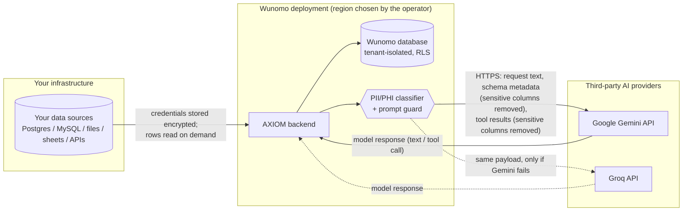

# What leaves Wunomo when AXIOM talks to an AI model

**Audience:** a customer's security or compliance reviewer, a data protection
officer, or a buyer evaluating AXIOM (the Wunomo DataOps agent) for use with
data covered by GDPR, HIPAA or similar. Written to be read without access to
the source code; where a claim is backed by an automated test, the test is
named so an engineer can verify it.

**Status:** current as of 2026-09-13, for the code at this revision. Provider
facts are quoted from the providers' own published terms on that date and must
be re-checked against the live terms before contractual reliance — Wunomo does
not control them.

---

## 1. The one-paragraph answer

AXIOM uses two third-party AI ("LLM") providers, **Google Gemini** (primary)
and **Groq** (fallback). When you ask AXIOM to do something, the text of your
request, the AI's working context, and *summaries or samples of results from
its tools* are sent to one of those providers over HTTPS to generate the
response. Your raw data stays in your Wunomo deployment. Before anything is
sent, every column of every connected source that Wunomo has classified as
personal or health data (PII/PHI) is **removed** — its name and its values —
from everything AI-bound. Your database credentials, API keys, audit log,
and the full contents of your sources are never sent to any AI provider.
A deployment-level setting (`LLM_DATA_RESIDENCY_MODE`) exists for EU-resident
or self-hosted inference; in this build the only implemented mode is
`global`, and the other modes refuse all AI calls rather than silently fall
back.

---

## 2. Data flow

Nothing else in the product makes an outbound AI call. Every AI call in the
codebase goes through one module (`services/llm_service.py`), and that module
is the single place the residency setting is enforced (section 6).

---

## 3. What is sent to the AI provider

Per request, one HTTPS call (two if the primary provider fails and the
fallback is used) carrying:

| Sent | Detail | Sensitive-column treatment |
|---|---|---|
| **Your typed request** | The chat message or transformation goal as you wrote it. | Not filtered. If you paste an SSN into the chat box, it is sent. |
| **AXIOM's system instructions** | Fixed text describing AXIOM's role and rules. | Contains no customer data. |
| **Your tenant identifier** | An opaque UUID so the model can address tools. | Not personal data; internal ID only. |
| **Schema metadata of a source** | Table names, column names, data types, and null/row counts — when you ask for a transformation against a source. | Columns classified PII/PHI are **omitted**. The model is told how many were withheld, not which. |
| **Sample rows from a source** | Up to 50 rows, when the AI previews a source to answer you. | PII/PHI columns are **removed** — name and values. |
| **Transformation results** | Rows produced by a SQL or Python transformation the AI ran. | PII/PHI columns are **removed** — name and values. |
| **Quality / pipeline / incident status** | Pass/fail counts, row counts, run timestamps, rule names, error messages. | Contains counts and names of rules and columns, not row values. |
| **Column names (schema discovery)** | When the AI profiles or lists a source, the column list — including classified columns *by name*, flagged with their classification — is returned to it so it knows they exist and are off-limits. | Names only. Values never. See section 5, residual 2. |
| **Task-planning context** | For multi-step tasks: the goal, the step list, and capped summaries of earlier steps' results. | Earlier results are the already-filtered tool results above. |

Which provider receives it is decided per call: Gemini first; Groq only when
Gemini errors or exceeds a 15-second ceiling. The same payload goes to
whichever one is used.

### 3.1 The classification that decides what is removed

When a source is profiled, every column is classified `none`, `pii` or
`phi` from its name (token-based — `customer_ssn`, `dateOfBirth`,
`medical_record_number`) and, where the connector supports it, from a sample
of its values (SSN, email, phone, payment-card, IP address patterns). The
classification is stored with the source's schema; the sampled values are
not. It deliberately over-includes: quasi-identifiers (`city`, `gender`,
`age_group`, `zip_code`) and credentials (`password_hash`, `api_key`) are
treated as sensitive. An administrator can override any column's level
(`PUT /api/v1/sources/{id}/classification`), and every override is written
to the tamper-evident audit log. Overrides survive re-profiling.

A source that has been connected but never profiled is classified on the
fly from the columns and values in the result being sent, so an unprofiled
source is not an unfiltered one.

**Verified by:** `backend/tests/test_pii_classification.py` and
`backend/tests/test_llm_data_residency.py`. Both intercept the real outbound
HTTP request at the last step before the network and assert, on the
serialised bytes, that classified column names and their values are absent —
for a direct transformation request and for a full chat turn in which the
AI previews a source. (The interception targets Groq because its client
library is plain HTTP; both providers receive the identical message list.)

---

## 4. What never leaves Wunomo's infrastructure

| Stays internal | Where it lives |
|---|---|
| The full contents of your data sources | Your systems; read on demand, never copied wholesale |
| Source connection credentials (DB passwords, API tokens, service-account keys) | Wunomo DB, encrypted at rest (Fernet), redacted on every read API |
| Values in any column classified PII/PHI | Never serialised into an AI-bound message |
| Your users' accounts, roles, sessions | Wunomo DB |
| The audit log (append-only, hash-chained per tenant, anchored daily) | Wunomo DB |
| Full transformation result sets | Wunomo DB stores a masked 20-row preview; the rest is returned to you and discarded |
| Uploaded files | Wunomo file storage |
| Chat history | Wunomo DB. Prior turns are re-sent to the provider as context on later turns — they contain only what section 3 allows. |
| Token counts, latency, model and provider per call | Wunomo DB (`llm_usage_events`) — metadata, no prompt text |

---

## 5. Known residuals — read these before signing anything

1. **Your own words are not filtered.** Anything a user types into AXIOM is
   sent as typed. Personal data pasted into a chat message reaches the
   provider.
2. **Classified column *names* are visible to the AI in schema-discovery
   results** (profile, list, drift detection). Values are not. A column name
   is schema metadata, not personal data under GDPR, but if your schema
   encodes personal data in column names (rare), treat this as exposure.
3. **Error messages pass through.** A database error message that quotes an
   offending value (Postgres does this for type-cast failures) can reach the
   provider inside a tool result or a task-adaptation prompt. Not filtered
   today.
4. **Classification is heuristic.** A free-text `notes` column containing
   personal data is not detected from its name, and value detection needs a
   recognisable pattern. Use the manual override for such columns.
5. **Two providers, one setting.** There is no per-tenant provider choice;
   the deployment's configuration applies to every tenant on it.

---

## 6. Where the AI processing happens — provider facts

Wunomo does not operate the models. The following is what the providers
publish; quotes are from the linked documents as read on 2026-09-13.

### Google Gemini API (primary)

Source: <https://ai.google.dev/gemini-api/terms>

- **Unpaid (free-tier) services:** Google "use[s] the content you submit …
  to provide, improve, and develop Google products and services", and
  "human reviewers may read, annotate, and process your API input and
  output". Google states data is disconnected from the account and API key
  before human review.
- **Paid services:** Google does "not use your prompts … or responses to
  improve our products", and processes data under its Data Processing
  Addendum as a processor.
- **EEA / Switzerland / UK:** the terms state that users in these regions
  **must use paid services only** — the unpaid terms are not offered there.
- **Processing location:** data "may be stored transiently or cached in any
  country in which Google or its agents maintain facilities". The Gemini
  Developer API offers no region pinning. (Google's Vertex AI product does
  offer EU regional endpoints; AXIOM does not use Vertex AI today.)
- **Retention (paid):** logs "for a limited period of time" for abuse and
  safety enforcement.

**Implication for this deployment:** the project's Gemini access is
currently on the free tier (a hard daily request cap is documented in the
engineering notes). For a customer in the EEA/UK that is a blocker on its
own: the free-tier terms permit human review and product improvement, and
Google's own terms exclude EEA/UK use of the unpaid service. Moving to a
paid Gemini key is a prerequisite for any EU customer, independent of
region.

### Groq (fallback)

Source: <https://groq.com/privacy-policy/> (the privacy policy governs Groq's
own site and account data; API request data is "Customer Data" governed by
the Groq Services Agreement and Data Processing Addendum, which are
contractual documents and must be obtained from Groq directly).

- **Processing location:** "Groq is located in the United States, and
  maintains processing operations in various global jurisdictions. We may
  therefore transfer your information to countries other than the country
  where you are located, including to the U.S."
- **Transfers:** Groq references "approved contractual protections for the
  transfer of information" and third-party Data Privacy Framework
  certifications "where applicable", and lists EU/UK GDPR representatives.
- **Training use and retention of API data:** not stated in the public
  privacy policy; governed by the DPA. Obtain and review the DPA.
- **Region pinning:** none offered on the public API as used by AXIOM.

---

## 7. The residency setting

`LLM_DATA_RESIDENCY_MODE` is a deployment environment variable read at boot
and enforced at the single point every AI call passes through.

| Value | Behaviour in this build |
|---|---|
| `global` (default) | AI calls go to the configured providers (Gemini, Groq) and are subject to the provider facts in section 6. |
| `eu` | **Refuses every outbound AI call** with a clear error (`DataResidencyError`), logged at boot and on each refusal. No EU-resident endpoint is implemented yet. |
| `self_hosted` | Same refusal. Intended for a customer-operated OpenAI-compatible endpoint at `LLM_SELF_HOSTED_ENDPOINT`; not implemented yet. |
| anything else | The application refuses to start. |

The refusal is deliberate. A residency setting that silently falls back to
the global providers would be a false promise; one that refuses is a true
statement of what this build can do. The non-AI parts of the product
(pipelines, quality checks, incidents, audit) keep working under `eu` and
`self_hosted`; only the conversational and generative features stop.

**What "implemented" will mean, when it lands:** `eu` routes every call to an
EU-region endpoint (candidates: Vertex AI `europe-west*` regions for Gemini;
an EU-hosted open-weight model) with the fallback also EU-resident;
`self_hosted` routes to the customer's endpoint with no fallback. Neither is
scheduled at the time of writing.

**Verified by:** `backend/tests/test_llm_data_residency.py` — under `eu` and
`self_hosted`, no HTTP request reaches any provider (asserted with the same
network-level interception as section 3.1).

---

## 8. Checklist for a reviewer

- [ ] Confirm the deployment's `LLM_DATA_RESIDENCY_MODE` and the region the
      Wunomo deployment itself runs in (operator-chosen; not fixed by the
      product).
- [ ] Confirm the Gemini key is on a **paid** plan if any EEA/UK data
      subjects are involved.
- [ ] Obtain Groq's Services Agreement and DPA; confirm training-use and
      retention terms.
- [ ] Review the classification of each connected source
      (`GET /api/v1/sources/{id}`) and override where the heuristic missed
      a column.
- [ ] Decide whether residual 1 (user-typed text) needs a usage policy.
